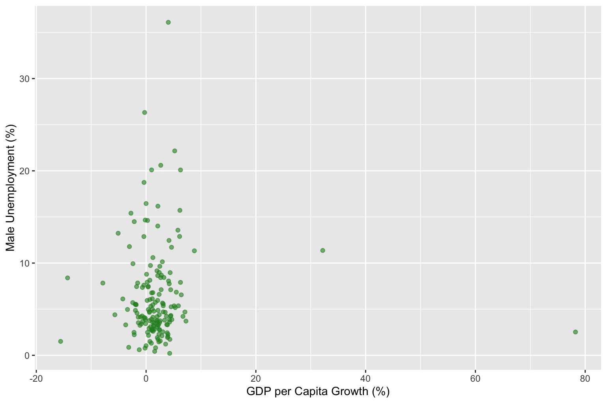
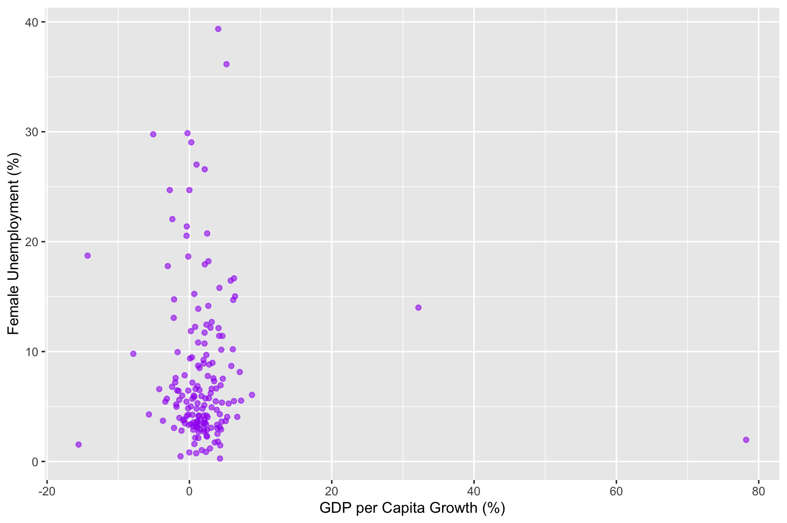
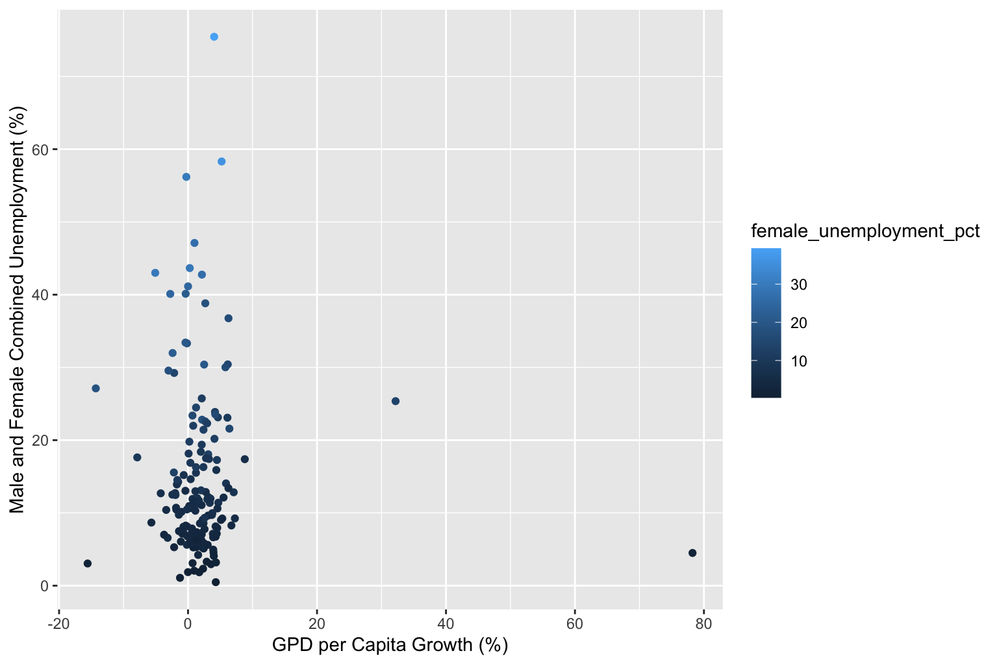

# Datathon at Los Angeles Community College (LACC) 

## Team NaNaNaNa
El Camino college 
- Sabrina Moore
- Kayla Perkins
- Chris Hurtado

## Dataset
<!--TO DO-->

## Task summary
My team attended the LACC Datathon event designed to create interest in data science with an introduction to R (and Rstudio) and a one hour data analysis competition. 

my Team had to analyze a dataset of countries with macroeconomic variables - GDP, unemployment percentages, literacy rates and other 
economic factors - create visualizations, and present on one of two general topics:

1. Does the GDP of a country affect unemployment in men or women?
2. Does the GDP of a country affect inflation?

## Hypothesis
My team worked on the hypothesis **'is there a disparity between how GDP affects men and women's unemployment rate?**'

We wanted to investigate whether economic stability and growth carry an implicit gender bias. Given the time limit of one hour and the scope of the dataset, our analysis focuses strictly on correlation rather than causation.

## Why compare men and women?

Men and women tend to cluster in different economic sectors and industries and are not equally impacted by the economy.
<!-- Give data/research proof -->

According to research by organizations like the International Labour Organization (ILO) and the World Bank, women in developing economies are often disproportionately concentrated in informal or vulnerable employment, making their workforce participation sensitive to broader macroeconomic shifts.
<!-- Give data/research proof -->

Demographic factors such as gender, race, and disability often highlight underlying structural inequities in access to stable employment during economic downturns.
<!-- Give data/research proof -->

## Methodology and Steps

1. Variable selection: 
- GDP per capita usd
- Male Unemployment Rate
- Female Unemployment Rate

2. Data cleaning: Handled missing values by removing null entries within the targeted feature subset.

3. Descriptive statistics: Computed summary statistics and compared average unemployment metrics between men and women.

4. Data Visualization: Plotted male, female, and combined unemployment rates against GDP to evaluate visual trends, inverse relationships, and outlier distribution.

## Visualizations

## Results

**Slight Disparity in Female Unemployment**: Female unemployment trends slightly higher on average, exhibiting a wider spread and a greater number of high-side outliers compared to male unemployment.

**Distribution Skewness**: Unemployment distribution across countries is strongly right-skewed, highlighting a smaller subset of nations with extreme unemployment rates.

**Non-Linear Trend with GDP**: In lower-GDP countries, both male and female unemployment rates display high variance and severe spikes (reaching 20–30%+). Higher GDP levels correspond to lower, more stabilized unemployment rates for both genders.

**Low-GDP Outliers**: Some low-GDP nations exhibit near-0% reported unemployment (often reflecting high informal economy participation), while others experience severe unemployment spikes.

## Discussion
The difference between male and female unemployment is small and does not support the idea that a country’s GDP alone affects women and men differently. Instead, both genders experience similar overall macroeconomic trends in relation to GDP scale. This is supported by 

## Self-Reflection
Because of the time constraint, here is a self-reflection of what we would've liked to do differently with more time:
- Reframing the hypothesis to control better for high GDP versus low GDP to gain more insight on macroeconomic influences.
- Dedicating a slide in the presentation to describing the dataset, the variables, and raw summary metrics prior to testing hypotheses.
- Expanded visualizations to reveal non-linear relationships.
- Examining the correlation coefficient as mean isn't enough to inform us about the significance between the two data points.

## Further Thoughts

- What other factors, like work domains/career fields, could contribute to the small gender gap?
- How does this trend change over time by comparing to historic data?

